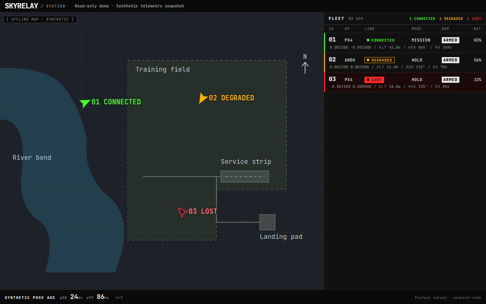

# SkyRelay

**An open-source bridge between MAVLink drones and DDS: one versioned data
model for several vehicles at once, independent of the autopilot, and measured
rather than claimed.**

The product is a contract: the IDL data model, the QoS profiles and the
benchmark method. The bridge, the gateway and the web station are reference
implementations of it.

## Status

**`v0.1.0-preview` — INSECURE PREVIEW.** There is no security yet: no
DDS-Security, no MAVLink signing, no TLS or authentication at the gateway. DDS
and the gateway are confined to loopback, and the station shows an INSECURE
PREVIEW banner, which cannot be closed, whenever it talks to a gateway. The
bridge's MAVLink ports (UDP 14540–14543) listen on every interface so the
simulation containers can reach them, and MAVLink is unsigned, so run it on a
machine and network you trust and do not expose it. Security arrives in M3
(see [Roadmap](#roadmap)).

What works today, telemetry only:

- **Simulation:** four PX4 v1.17 SIH quadrotors in Docker, one container each.
- **`skyrelay-bridge`:** MAVLink 2 over UDP into five DDS topics, one session
  per vehicle, a link monitor (connected, degraded, lost, recovering) and a
  clean re-setup when a vehicle reboots. Towards the vehicles it sends only
  its heartbeat, message-rate requests and a request for `AUTOPILOT_VERSION`;
  there are no operator commands yet.
- **Contract:** IDL v1 telemetry types, with JSON converters, TypeScript types
  and a field table generated from the IDL.
- **`skyrelay-gateway`:** serves the station and the offline map, and streams
  telemetry to browsers as JSON over a WebSocket. It listens on loopback only
  and refuses foreign `Host` and `Origin` headers.
- **Web station:** offline map, fleet panel with link states, and a pose-age
  HUD. A standalone demo with synthetic data needs nothing else.
- **Benchmark:** `skyrelay-bench-probe` and `bench/run.sh`, with a p99 gate.
- **CI:** builds and unit tests on Ubuntu 24.04 (GCC 13) and 26.04 (GCC 15), a
  licence check on every C++ dependency installed through vcpkg, and a nightly
  end-to-end simulation benchmark.

Only PX4 has been tested. The ArduPilot adapter, commands and missions come in
M2.

## Why

Drones speak MAVLink. Larger systems (control stations, mission software,
analytics) increasingly speak DDS. Every maintained route from a drone onto DDS
belongs to one autopilot (PX4's uXRCE-DDS, ArduPilot's AP_DDS) and exposes that
autopilot's internal messages. The tools that work with any autopilot either
need ROS, serve one vehicle at a time, or forward raw frames without a typed
data model. And nobody publishes multi-vehicle latency numbers that someone
else can reproduce.

SkyRelay aims at that gap: one bridge, one versioned data model, PX4 and
ArduPilot alike, several vehicles at once, and every number backed by a
benchmark you can rerun. The evidence is in the
[landscape research](docs/research/landscape-2026-11.md).

## Architecture

```
  sim/sih-px4-4             4 × PX4 v1.17 SIH, one container each
        │  MAVLink 2 over UDP, host ports 14540–14543
        ▼
  skyrelay-bridge           one session per vehicle, link monitor
        │  DDS: skyrelay/v1/* topics, domain 42, loopback only
        ├──────────────────────────────┐
        ▼                              ▼
  skyrelay-gateway          skyrelay-bench-probe
        │  HTTP + WebSocket (JSON)     │  pose.csv → bench/report/latency.py
        │  127.0.0.1:8080              ▼
        ▼                       p50 / p95 / p99, gate p99 ≤ 100 ms
  web station (browser)
```

The gateway is just another DDS participant, which keeps the bridge small and
shows that any third-party DDS application can consume the contract. The full
design, including the parts not built yet, is in
[the design document](docs/design/2026-11-23-skyrelay-design.md).

## Quickstart

### Prerequisites

- Linux on x86_64.
- Docker Engine with the Compose plugin, and permission to use it. The first
  start builds PX4 from source, which needs about 10 GB of disk and some
  minutes.
- GCC 13 or newer, CMake 4.2 or newer, Ninja, and what vcpkg needs (git, curl,
  zip, unzip, tar, pkg-config).
- [vcpkg](https://github.com/microsoft/vcpkg), cloned and bootstrapped, with
  `VCPKG_ROOT` pointing at it. `vcpkg.json` pins the baseline. The first
  configure builds every dependency once, which takes a while.
- Node.js 24 with npm, and Python 3.12 or newer.

### Run it

From the repository root:

1. Fetch the offline map region into `data/`. After this the station needs no
   internet. The tiles come from a Protomaps daily build, and those are kept
   for only about two months; if the pinned one is gone, pick a newer date
   with `PROTOMAPS_BUILD=YYYYMMDD tools/maps/fetch-region.sh`.

   ```sh
   tools/maps/fetch-region.sh
   ```

2. Build the bridge, gateway and probe, then the station.

   ```sh
   cmake --preset dev
   cmake --build --preset dev
   (cd web/station && npm ci && npm run build)
   ```

3. Start the four simulated vehicles.

   ```sh
   docker compose -f sim/sih-px4-4/compose.yaml up -d
   ```

4. Start the bridge in its own terminal.

   ```sh
   build/dev/apps/bridge/skyrelay-bridge --config config/bridge.sih-px4-4.yaml
   ```

   The configuration gives each vehicle an id, a UDP link and, with `sysid`,
   the MAVLink system id it must use; a vehicle without `sysid` locks to the
   first autopilot heartbeat on its port. The accepted keys are listed in
   `apps/bridge/src/config.hpp`.

5. Start the gateway in another terminal.

   ```sh
   build/dev/apps/gateway/skyrelay-gateway --listen 127.0.0.1:8080 \
       --web-root web/station/dist --data-dir data
   ```

6. Open <http://127.0.0.1:8080/>. The four vehicles appear on the map and in
   the fleet panel within a few seconds.

`curl -s http://127.0.0.1:8080/healthz` prints `ok` while the gateway is up. To
stop, press Ctrl-C in the gateway and bridge terminals, then run
`docker compose -f sim/sih-px4-4/compose.yaml down`.

If no vehicle shows up, stop the bridge and run
`python3 sim/check_heartbeats.py --ports 14540-14543 --timeout 90` to see
whether the simulation is sending; [sim/README.md](sim/README.md) has the
details. For working on the station with Vite's dev server, see
[docs/gateway-protocol.md](docs/gateway-protocol.md).

## Quick look without the simulation

The station has a standalone demo that runs entirely in the browser. **All of
its data is synthetic:** three made-up vehicles on a schematic map, fixed
pose-age samples, and a scripted 12 s link replay in which vehicle 01 degrades
at 3 s, loses its link at 5 s, starts recovering at 8 s and reconnects at 10 s.
No gateway, simulator or vehicle is involved, and none of its numbers are
measurements.

```sh
cd web/station
npm ci
npm run build
npm run preview -- --host 127.0.0.1 --port 4173 --strictPort
```

Open <http://127.0.0.1:4173/?demo=1>.



## Benchmark

The M1 clean profile measured an overall **p99 of 0.260 ms** (p50 0.118 ms,
p95 0.203 ms, 4658 samples) from bridge decode to the DDS consumer. That is
one 60 s run on one host, with four simulated vehicles, no link impairment
and DDS over loopback. It covers only that segment: the vehicle, the link, the
gateway and the browser are left out, so it is the cost the bridge and DDS add,
not an end-to-end latency. The vehicle-side method arrives with the link
emulators in M4. Full report:
[M1 clean, 2026-11-23](docs/benchmarks/2026-11-23-m1-clean.md).

To reproduce it, stop the quickstart stack first (bridge, gateway and
`docker compose … down`), because the benchmark starts its own simulation and
bridge on the same UDP ports. It needs Docker and the build from step 2 above:

```sh
bench/run.sh m1-clean
```

It starts the simulation, the bridge and the probe, records `pose` for 60 s,
writes the report to `bench/results/`, tears everything down, and exits
non-zero if the p99 is over 100 ms. CI runs the same scenario every night; see
[docs/benchmarks](docs/benchmarks/README.md).

## Data contract

- [docs/contract.md](docs/contract.md): the five M1 topics, the common
  header, `valid_mask`, QoS profiles and publish rates.
- [idl/skyrelay/v1/types.idl](idl/skyrelay/v1/types.idl): the types
  themselves. Where the docs and the IDL disagree, the IDL is right.
- [docs/contract/v1-fields.md](docs/contract/v1-fields.md): every field with
  its unit and `valid_mask` bit, generated from the IDL.
- [docs/gateway-protocol.md](docs/gateway-protocol.md): the gateway's HTTP
  routes and the JSON it streams to browsers.

## Roadmap

| Milestone | Delivers |
|---|---|
| M2 Commands and missions | Command lifecycle, mission upload, ArduPilot adapter, lost-link handling, conformance checker, MCAP recording and deterministic replay |
| M3 Security | DDS-Security on by default, MAVLink 2 signing, gateway TLS and authentication, threat model, interop matrix |
| M4 Fault-injection benchmark | Network impairment profiles, vehicle-side latency, isolation between vehicles, results with security on |
| M5 Video and KLV | MISB ST 0601 metadata per frame, camera footprint on the map, video latency |
| M6 Release | Offline, signed release bundle with an SBOM |

Releases before M3 are tagged `v0.x.0-preview` and are insecure. Details are in
[the design document, §16](docs/design/2026-11-23-skyrelay-design.md#16-milestones).

## Docs

- [System design](docs/design/2026-11-23-skyrelay-design.md)
- [Architecture decision records](docs/adr/)
- [Data contract](docs/contract.md) and [field table](docs/contract/v1-fields.md)
- [Gateway protocol](docs/gateway-protocol.md)
- [Benchmarks](docs/benchmarks/README.md)
- [Simulation](sim/README.md)
- [Code generation](tools/codegen/README.md)
- [Landscape research (Nov 2026)](docs/research/landscape-2026-11.md)
- [Changelog](CHANGELOG.md)

## Licence

[Apache-2.0](LICENSE). Everything linked into the SkyRelay binaries is under a
permissive licence: the C++ dependencies installed through vcpkg, and the
vendored MAVLink C headers (MIT, see `third_party/mavlink/NOTICE`). CI fails if
any port installed through vcpkg is under the GPL or AGPL
(`tools/check_licenses.py`). The vendored headers and the web station's npm
packages are not part of that check.
